# CandyRun

*[English version below](#candyrun-english)*

CandyRun é um jogo de labirinto em que você foge de suas rivais, que prenderam os seus pets e estão correndo atrás de você, enquanto come os doces espalhados pelo chão. 

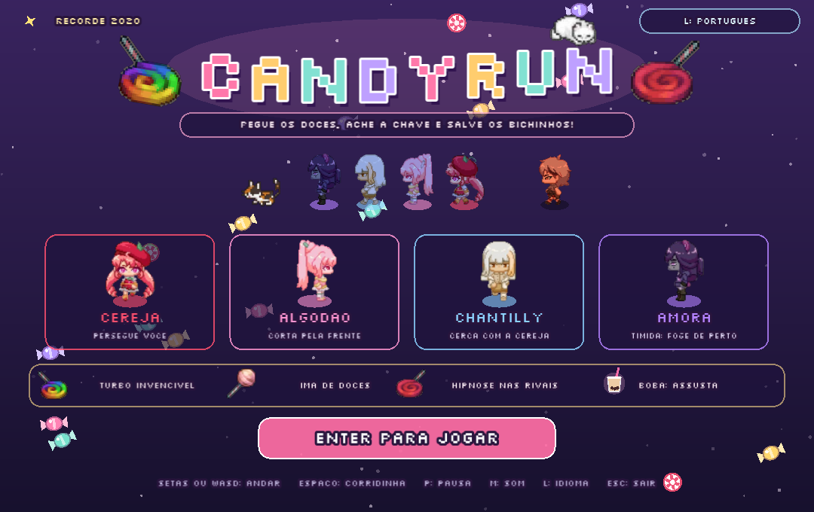
*Tela inicial.*
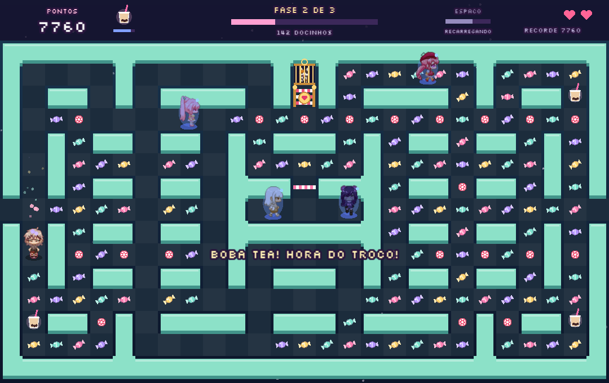
*Em jogo.*
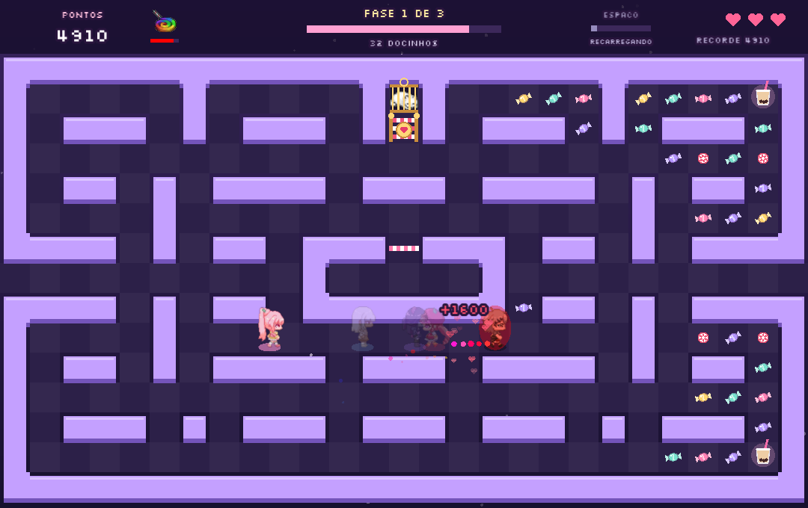
*Exemplo de poder: turbo arco-íris.*
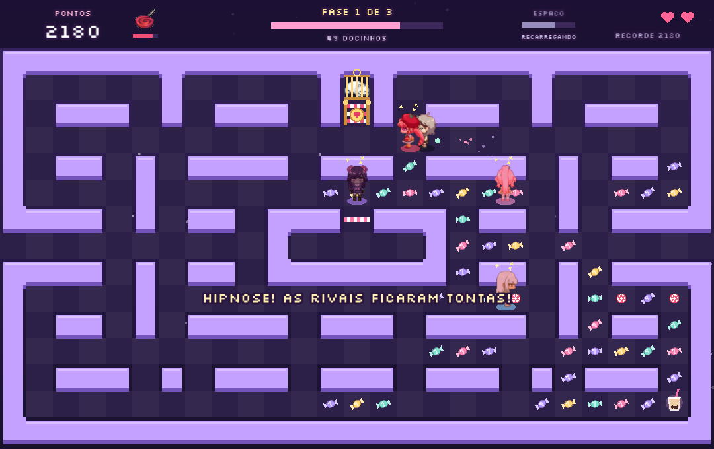
*Exemplo de poder: hipnose.*
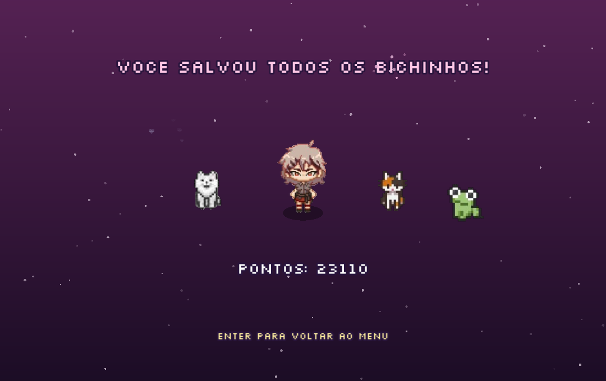
*Os três pets salvos.*
Você se pergunta como os doces se espalharam por todos os cantos.

# Inspiração

Este projeto surgiu da vontade de dar uma segunda chance a um jogo que desenvolvi na disciplina de programação I. 
Quando o desenvolvi, ainda não tinha experiência alguma com programação, e a implementação original apresentava limitações na organização e modularização do código, além de sérios problemas estéticos.

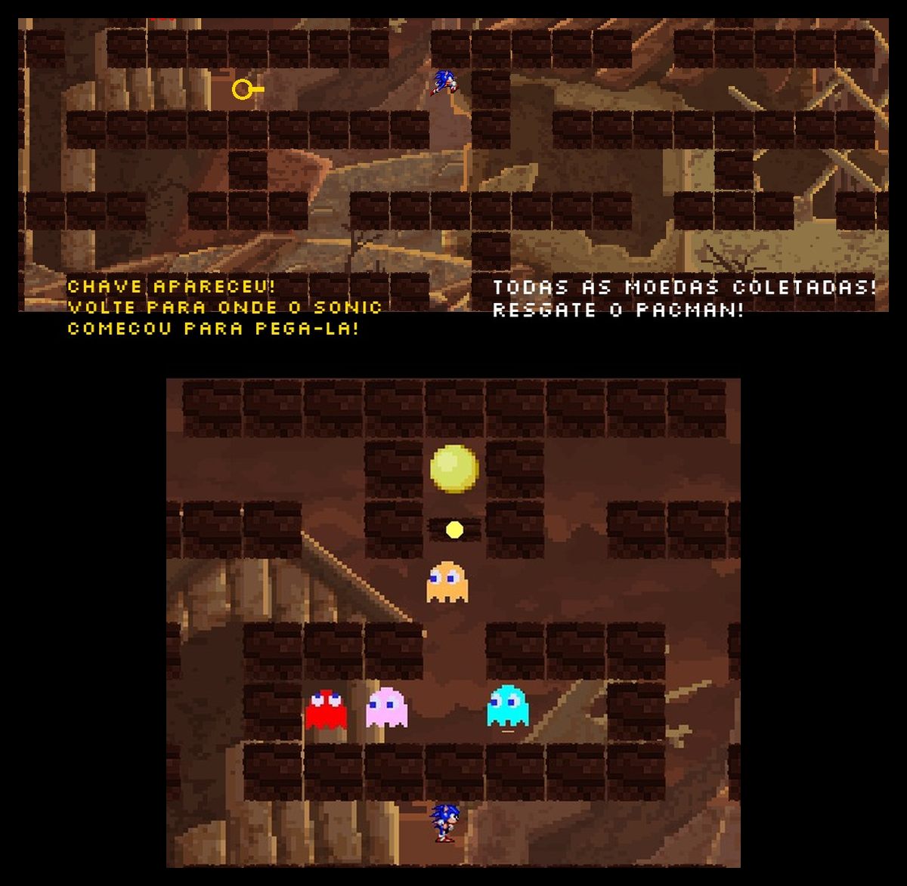
*A-Pac-lipse*

## Compilar e jogar

Precisa de **CMake** (3.28 ou mais novo) e compilador C++20. O SFML 3.1 não precisa instalar: na primeira vez o CMake baixa e compila sozinho (leva alguns minutos).

Em qualquer sistema (Windows, Linux ou Mac):

```
cmake -B build
cmake --build build
```

O `candyrun` fica na pasta do projeto, ao lado de `assets/`. No Windows também dá pra usar o atalho `build.bat run`, que roda esses dois comandos e abre o jogo.

- No Windows o `candyrun.exe` sai com tudo dentro: roda em outro PC sem SFML nem MinGW.
- No Linux, o SFML precisa de algumas bibliotecas do sistema (no Ubuntu: `sudo apt install libxrandr-dev libxcursor-dev libxi-dev libudev-dev libgl1-mesa-dev`).


## Controles

| Tecla | Ação |
|---|---|
| Setas / WASD | andar (a direção fica guardada até dar pra virar) |
| Espaço | corridinha (um pique rápido, recarrega em 7s) |
| P ou Esc | pausar |
| M | liga/desliga o som |
| Enter | começar / voltar ao menu |

## Regras

- Você deve comer todos os doces para passar de fase.
- Após comer todos os doces, a **chave** aparece para abrir a gaiola e salvar o pet da fase: um cachorro na fase 1, um gato na fase 2 e um sapo na fase 3.
- As rivais alternam entre "espalhar" (cada uma vai pro seu canto) e "perseguir":
  - **Cereja** persegue direto (e fica mais rápida quando faltam poucos docinhos);
  - **Algodão** mira 4 casas na sua frente;
  - **Chantilly** usa a posição da Cereja pra te cercar;
  - **Amora** persegue de longe, mas foge quando chega perto.
- Você tem 3 vidas, e ganha uma extra aos 10.000 pontos.

## Organização

```
src/candyrun/
  main.cpp          começa o jogo
  comum.hpp         funções pequenas
  mapa.*            desenha as paredes
  personagens.*     movimento e escolhas de caminho
  efeitos.*         efeitos visuais
  sons.*            música gerada por IA
  jogo.*            regras, fases, telas, recorde
  desenho.cpp       tudo que aparece na tela (inclusive a barra de título)
  janela_sistema.*  minimizar e cantos retos da janela (Windows)
  icone.rc          ícone do candyrun.exe

CMakeLists.txt      como compilar (baixa o SFML sozinho)

assets/fases/       mapas das 3 fases
assets/sprites/     sprite sheets das personagens, dos pets e dos pirulitos
assets/icone.*      ícone do jogo, o pirulito arco-íris
```

---

# CandyRun (English)

CandyRun is a maze game in which you run from your rivals, who locked up your pets and are now chasing you, while you eat the candy scattered on the floor.

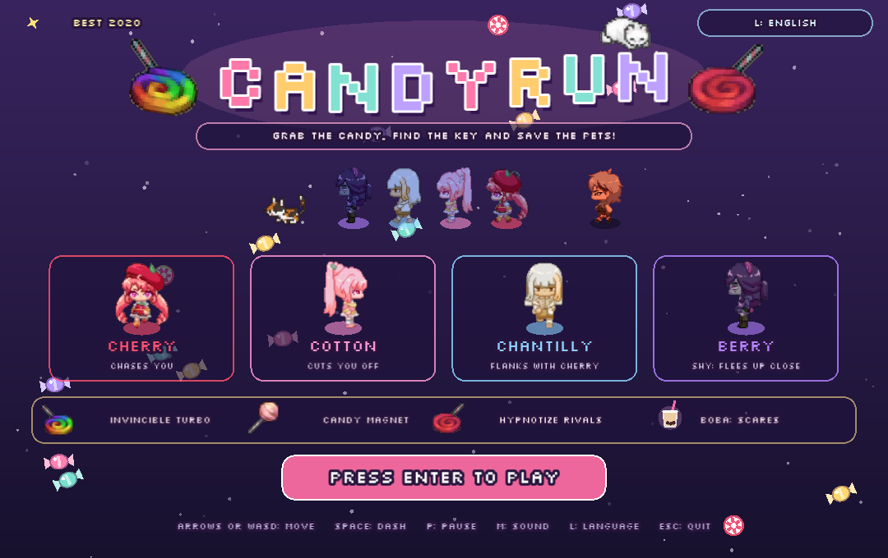
*Title screen.*
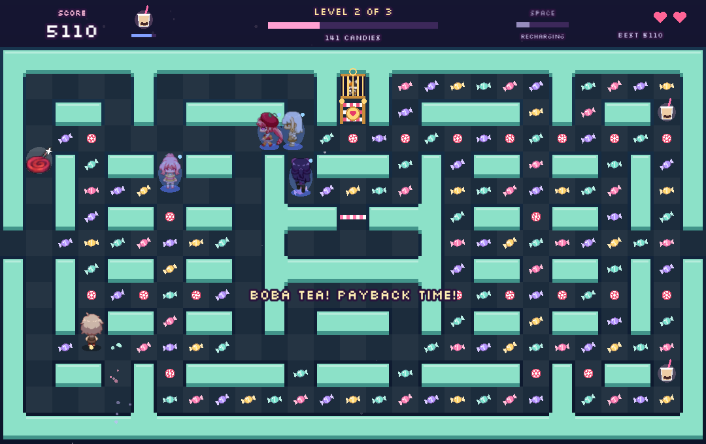
*In game.*
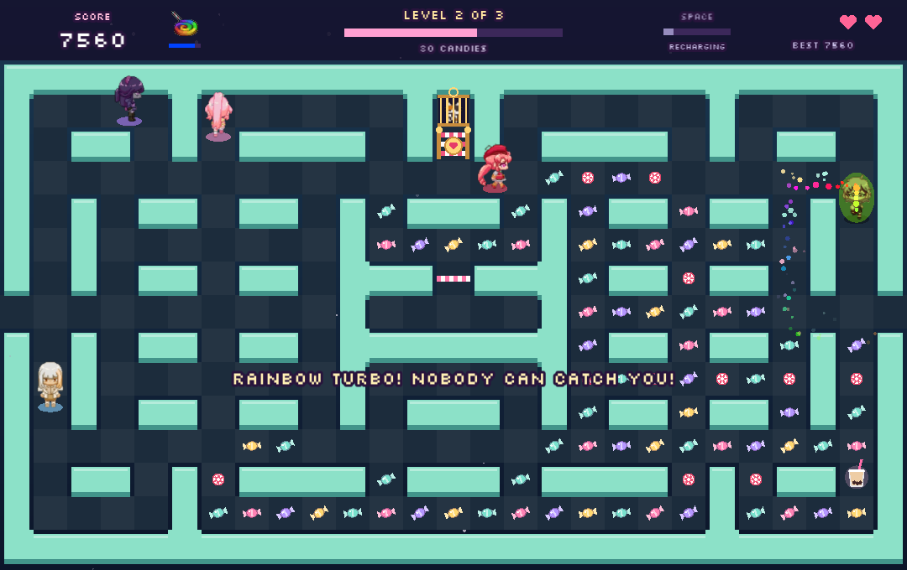
*Power example: rainbow turbo.*
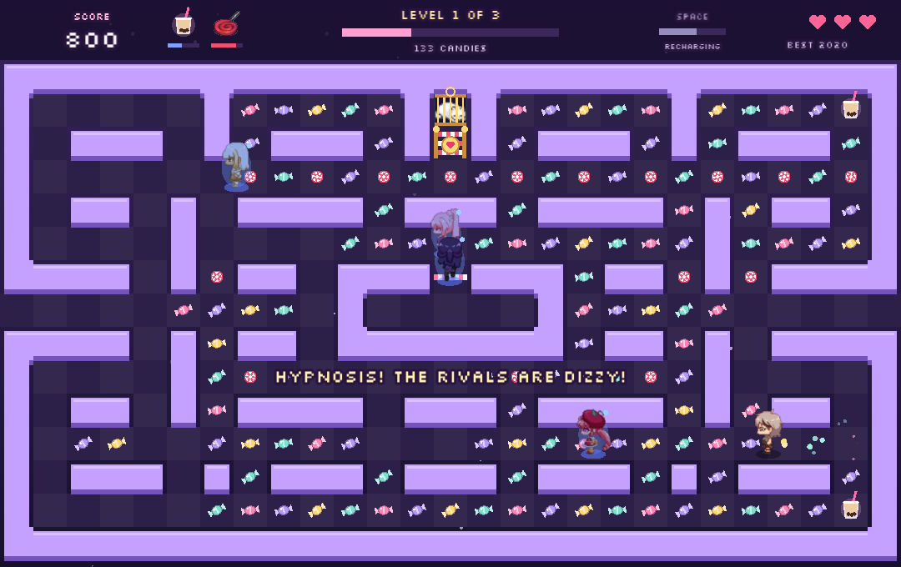
*Power example: hypnosis.*
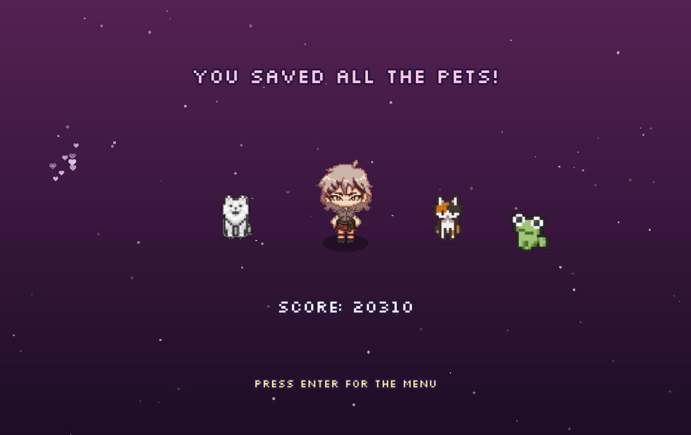
*All three pets saved.*
You wonder how the candy ended up scattered everywhere.

# Inspiration

This project came from the idea of giving a second chance to a game I made in my Programming I course.
When I made it, I had no programming experience at all, and the original implementation had limitations in how the code was organized and modularized, as well as serious visual problems.


*A-Pac-lipse*

## Build and play

You need **CMake** (3.28 or newer) and a C++20 compiler. You don't need to install SFML 3.1: the first time, CMake downloads and builds it by itself (it takes a few minutes).

On any system (Windows, Linux or Mac):

```
cmake -B build
cmake --build build
```

`candyrun` ends up in the project folder, next to `assets/`. On Windows you can also use the `build.bat run` shortcut, which runs those two commands and opens the game.

- On Windows, `candyrun.exe` comes out with everything inside: it runs on another PC without SFML or MinGW.
- On Linux, SFML needs a few system libraries (on Ubuntu: `sudo apt install libxrandr-dev libxcursor-dev libxi-dev libudev-dev libgl1-mesa-dev`).

## Controls

| Key | Action |
|---|---|
| Arrows / WASD | move (the direction is remembered until you can turn) |
| Space | dash (a quick sprint, recharges in 7s) |
| P or Esc | pause |
| M | sound on/off |
| L | switch language (Portuguese / English), on the menu or while paused |
| Enter | start / back to the menu |

## Rules

- You must eat all the candy to clear the level.
- After you eat all the candy, the **key** appears so you can open the cage and save that level's pet: a dog on level 1, a cat on level 2 and a frog on level 3.
- The rivals switch between "scatter" (each one goes to her own corner) and "chase":
  - **Cherry** chases you directly (and gets faster when only a few candies are left);
  - **Cotton** aims 4 tiles ahead of you;
  - **Chantilly** uses Cherry's position to surround you;
  - **Berry** chases from far away, but runs when she gets close.
- You have 3 lives, and you earn an extra one at 10,000 points.

## Project layout

```
src/candyrun/
  main.cpp          starts the game
  comum.hpp         small functions
  mapa.*            draws the walls
  personagens.*     movement and path choices
  efeitos.*         visual effects
  sons.*            AI-generated music
  jogo.*            rules, levels, screens, high score
  desenho.cpp       everything drawn on screen (including the title bar)
  janela_sistema.*  window minimize and square corners (Windows)
  icone.rc          candyrun.exe icon

CMakeLists.txt      how to build (downloads SFML by itself)

assets/fases/       maps for the 3 levels
assets/sprites/     sprite sheets for the characters, pets and lollipops
assets/icone.*      game icon, the rainbow lollipop
```
